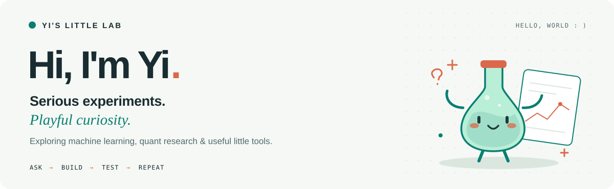

<picture>
  <source media="(max-width: 600px) and (prefers-color-scheme: dark)" srcset="assets/header-mobile-dark.svg">
  <source media="(max-width: 600px)" srcset="assets/header-mobile-light.svg">
  <source media="(prefers-color-scheme: dark)" srcset="assets/header-dark.svg">
  <source media="(prefers-color-scheme: light)" srcset="assets/header-light.svg">
  
</picture>

  Exploring machine learning and quantitative research through code, careful experiments, and a healthy supply of “what if?” 
  <strong>Curious by nature. Evidence by habit.</strong>

  <a href="#interests">Interests</a> &nbsp;·&nbsp;
  <a href="#skills">Skills</a> &nbsp;·&nbsp;
  <a href="#workbench">Workbench</a> &nbsp;·&nbsp;
  <a href="#say-hi">Say hi</a>

## 🔬 Research interests

- **Machine learning** — learning from data, exploring retrieval-augmented systems, and evaluating models through reproducible experiments.
- **Quantitative research** — turning market questions into factors, testing signals with time-series analysis, and accounting for trading costs in backtests.

## 🛠️ Skills — what I can do

| Area | Practical skills |
| :--- | :--- |
| **Machine learning & data** | Data preparation, statistical and time-series analysis, model experimentation, and visualization with **Python, pandas, NumPy, and scikit-learn**. |
| **Quantitative research** | Factor computation, **IC/ICIR evaluation**, portfolio backtesting, and transaction-cost analysis with **Python, SQL, and DuckDB**. |
| **LLMs & retrieval** | Event extraction, embedding-based retrieval, LLM API evaluation, batch inference, caching, and reproducible data pipelines. |
| **Full-stack development** | Interactive interfaces and REST APIs with **React, TypeScript, Node.js, FastAPI, and Java/Spring Boot**; database integration with **PostgreSQL, MySQL, and MongoDB**. |
| **Engineering & systems** | Version control, environment automation, containerized workflows, and cloud tooling with **Git, Shell, Docker, and Google Cloud**. |

**Languages:** `Python` `Java` `C` `C++` `SQL` `JavaScript` `TypeScript` `HTML/CSS` `Shell`

## 🧪 On my workbench

| Project | On the bench | Stack |
| :--- | :--- | :--- |
| [Single-factor research](https://github.com/YiPan1028/Quant-Structure-Single-Factor) | A-share factor research, IC/ICIR analysis, and cost-aware backtests. | Python · DuckDB |
| [LoveCare](https://github.com/YiPan1028/Hackthon_Project) | A hackathon prototype for mood check-ins and daily reflections. | React · TypeScript |
| [Learning shelf: RAG & agents](https://github.com/YiPan1028/oreilly-retrieval-augmented-gen-ai) | O’Reilly course code I’m exploring as a learning reference. | Python · Notebooks |

### A few lab rules

1. **Start with a question.** Bonus points if it begins with “what if?”
2. **Let the evidence argue back.** A surprising result is an invitation to investigate.
3. **Keep the experiment reproducible.** Future me deserves a fighting chance.

## 👋 Say hi

Have an interesting question, a useful tool, or a beautifully weird experiment?  
Find me here: [@YiPan1028](https://github.com/YiPan1028).

<picture>
  <source media="(max-width: 600px) and (prefers-color-scheme: dark)" srcset="assets/footer-mobile-dark.svg">
  <source media="(max-width: 600px)" srcset="assets/footer-mobile-light.svg">
  <source media="(prefers-color-scheme: dark)" srcset="assets/footer-dark.svg">
  <source media="(prefers-color-scheme: light)" srcset="assets/footer-light.svg">
  
</picture>
